# Direito Fácil — Banco de Dados (Oracle PL/SQL + MongoDB)

Global Solution 2026/2 · CitizenTech · 2TDSPG
Disciplina: **Mastering Relational and Non-Relational Database**
Entrega: 19/11/2026, até 23h55 (Portal do Aluno)

> **Status deste repositório:** as partes **Oracle** e **MongoDB** estão completas, executadas e documentadas com prints (seções 6.2 e 6.3 e `documentacaoDB.pdf`).

---

## 1. Problema CitizenTech

Famílias de pessoas com autismo, deficiência ou idosas de baixa renda não sabem **a quais direitos federais o laudo médico dá acesso**, nem em que ponto cada pedido está parado. O app lê o laudo, confere cada direito do catálogo e acompanha cada pedido (caso) até a concessão.

**Princípio: "a regra decide, a IA explica".** Quem decide se a pessoa é `ELEGIVEL`, `POSSIVEL` ou `NAO_ELEGIVEL` é o **Oracle (PL/SQL)**, a partir de critérios guardados em tabela (frações do salário mínimo). A IA (Spring AI) só extrai dados do laudo e explica o passo a passo. Por isso a decisão é determinística, testável e auditável.

ODS: 3 (Saúde e bem-estar), 10 (Redução das desigualdades), 11 (Cidades e comunidades sustentáveis).

Base legal usada na regra de TEA: Lei 12.764/2012, art. 1º, §2º — a pessoa com TEA é considerada pessoa com deficiência (PcD) para todos os efeitos legais. Por isso um laudo de autismo abre direitos de PcD (`TIPO_CONDICAO = 'TEA'` conta como PcD na função de elegibilidade).

---

## 2. Ordem de execução

### Oracle (SQL Developer, schema do aluno; feche abas antigas e rode direto do disco)

| # | Arquivo | O que faz | Requisito do PDF |
|---|---|---|---|
| 0 | `00_DROP.sql` | Reset completo (opcional, seguro de rodar duas vezes) | — |
| 1 | `01_DDL.sql` | 14 tabelas em 3FN, PK/FK/UK/CHECK | 2+ tabelas relacionadas |
| 2 | `02_PROCEDURES.sql` | 8 procedures de carga (`PRC_CARGA_*`) com log de erro | — |
| 3 | `03_CARGA.sql` | Dados de teste: 6 usuários, 5 pessoas, 5 documentos, 5 laudos, 20 direitos, 20 critérios e os 41 itens do elenco do Farmácia Popular | dados de teste |
| 4 | `04_BLOCOS_PLSQL.sql` | **2 blocos anônimos**: cursor + `FOR LOOP` + `IF/ELSIF`; `WHILE` + `CASE` | 2 blocos PL/SQL |
| 5 | `05_FUNCOES_PROCEDURES_GATILHOS.sql` | **2 funções + 3 procedures + 2 gatilhos**, abre os casos e roda os testes | funções, procedures, gatilhos |
| 6 | `06_PACKAGES.sql` | **4 pacotes** (spec + body) + gatilho de auditoria delegando ao pacote + testes | 2+ pacotes com testes |
| 7 | `07_RELATORIOS_ORACLE.sql` | 3 relatórios equivalentes às consultas do MongoDB | comparação |
| 8 | `08_EXPORTA_JSON.sql` | (opcional) exporta os casos como JSON montado à mão | transição |

### Arquivos deste repositório

| Item | O que é |
|---|---|
| `00_DROP.sql` a `08_EXPORTA_JSON.sql` | Scripts Oracle, na ordem de execução |
| `mongo/` | Scripts MongoDB: carga de 2 collections (36 documentos) e as 3 consultas |
| `flyway/` | O mesmo banco em migrations `V1` a `V5`, sem comandos de SQL*Plus, para a API Java |
| `evidencias/` | Prints da execução no Oracle SQL Developer |
| `documentacaoDB.pdf` | Documentação com os requisitos atendidos e todas as evidências |

### MongoDB (mongosh ou Compass → `_MONGOSH`)

| # | Arquivo | O que faz |
|---|---|---|
| 1 | `mongo/01_setup_e_carga.js` | Seleciona/cria o database `citizentech`, cria 2 collections (com validação e índices), insere **36 documentos** |
| 2 | `mongo/02_consultas.js` | 2 `find` + 1 `aggregate`, equivalentes aos relatórios do Oracle |

```bash
mongosh "mongodb://localhost:27017" --file mongo/01_setup_e_carga.js
mongosh "mongodb://localhost:27017" --file mongo/02_consultas.js
```

Há ainda a pasta `flyway/` (`V1` a `V5`), com o mesmo banco sem comandos de SQL*Plus, para o time de Java copiar para `src/main/resources/db/migration` (seção 7).

Todos os scripts são reexecutáveis. Datas dos testes são fixas (`05/11/2026`) para o resultado ser sempre o mesmo.

---

## 3. Modelo Oracle

```
T_DF_USUARIO (1) ──< T_DF_PESSOA (1) ──< T_DF_DOCUMENTO (1) ──< T_DF_LAUDO
                            │            (também 1 ──< T_DF_LAUDO pela pessoa)
                            │
                            └──< T_DF_CASO >── (N) T_DF_DIREITO (1) ── (1) T_DF_CRITERIO_DIREITO
                                     │
                                     └── (via gatilho) T_DF_AUDITORIA_CASO

T_DF_SALARIO_MINIMO  (parâmetro de renda)      T_DF_LOG_ERRO  (erros das procedures)
```

| Tabela | Papel |
|---|---|
| `T_DF_USUARIO` | Login do app: perfil `CIDADAO` ou `GESTOR` (vira a role do JWT) |
| `T_DF_PESSOA` | Beneficiário (idade, renda familiar, **renda individual**, nº de membros) acompanhado por um usuário responsável |
| `T_DF_DOCUMENTO` | Registro, **neste banco**, de cada documento de laudo anunciado pelo evento `DocumentoRecebido`: metadados e `DES_ID_EXTERNO` (id do documento na API .NET, **sem FK**, pois os bancos são independentes). `DES_CHAVE_IDEMPOTENCIA` é única: se o RabbitMQ entregar o mesmo evento duas vezes, o Java não cria um segundo registro. Status `RECEBIDO`, `PROCESSADO` ou `ERRO` |
| `T_DF_ORIENTACAO` | Passo a passo em linguagem simples gerado pela IA (RAG) e gravado pelo Java, com a **fonte citada** (lei ou cartilha). 1:1 com o caso; o app mobile lê pela API |
| `T_DF_LAUDO` | Dados estruturados do laudo (ligado ao documento): CID, condição, `TIPO_CONDICAO` (`TEA`, `DEF_FISICA`, …, `OUTRA`) |
| `T_DF_DIREITO` | Catálogo de 20 direitos federais (órgão, base legal, prazo, `STA_VERIFICACAO`) |
| `T_DF_CRITERIO_DIREITO` | **A regra em tabela**: idade mín/máx, exige PcD, exige TEA, tipo de deficiência exigido (ex.: só física), fração do SM, `STA_RENDA_INDIVIDUAL` (renda da pessoa em vez da per capita), tolerância |
| `T_DF_CASO` | Pedido de um direito: status, resultado da avaliação, motivo, prazo. `UNIQUE(pessoa, direito)` |
| `T_DF_AUDITORIA_CASO` | Trilha: usuário, data, operação, status/valores antigo e novo |
| `T_DF_SALARIO_MINIMO` | Valor do salário mínimo por ano |
| `T_DF_LOG_ERRO` | Toda procedure grava aqui quando cai em `EXCEPTION` |
| `T_DF_MEDICAMENTO_FP` | **Elenco oficial do Farmácia Popular** (39 medicamentos + 2 insumos, por indicação), com fonte e data do elenco |
| `T_DF_RECEITA` | Receita enviada pela pessoa (foto no .NET; aqui fica o registro, opcionalmente ligado a `T_DF_DOCUMENTO`) |
| `T_DF_RECEITA_ITEM` | Cada remédio **conferido pela pessoa**: o que a IA leu, o que foi confirmado, se houve correção, o resultado (`GRATUITO`, `DOSAGEM_DIVERGENTE` ou `NAO_ENCONTRADO`) e a orientação |

### Regra de elegibilidade (`FN_AVALIAR_ELEGIBILIDADE` → `PRC_AVALIAR_DIREITO`)

Avalia na ordem e para na primeira falha:

1. Idade fora da faixa → `NAO_ELEGIVEL`
2. Direito exige TEA e não há laudo de TEA → `NAO_ELEGIVEL`
3. Direito exige PcD e não há laudo de deficiência (TEA conta) → `NAO_ELEGIVEL`
4. Direito exige um tipo específico de deficiência (ex.: a isenção de IOF exige deficiência física) e não há laudo desse tipo → `NAO_ELEGIVEL`
5. Sem limite de renda → `ELEGIVEL`
6. Renda (em SM) ≤ limite → `ELEGIVEL`. A renda é **per capita** (renda familiar ÷ nº de membros) na maioria dos direitos e **individual** (renda da própria pessoa) quando o critério tem `STA_RENDA_INDIVIDUAL = 'S'`, como no passe do idoso (Estatuto da Pessoa Idosa, art. 40: renda de até 2 SM)
7. Até o limite + tolerância (padrão 20%) → `POSSIVEL` ("confirmar renda no CadÚnico")
8. Acima → `NAO_ELEGIVEL`

`PRC_ABRIR_CASOS` percorre o catálogo com cursor e abre um caso para cada direito `ELEGIVEL` ou `POSSIVEL` (não duplica).

### Gatilhos

| Gatilho | Tipo | O que faz |
|---|---|---|
| `TRG_DF_CASO_VALIDA` | `BEFORE INSERT OR UPDATE` | Caso nasce `ABERTO`; prazo ≥ abertura; fluxo de status (`PROTOCOLADO` só vai para `CONCEDIDO`/`NEGADO`; estados finais não mudam) |
| `TRG_DF_AUDITORIA_CASO` | `AFTER INSERT OR UPDATE OR DELETE` | **Trilha de auditoria** com data, operação, `:OLD`/`:NEW` |

### Pacotes (06)

| Pacote | Conteúdo |
|---|---|
| `PKG_ELEGIBILIDADE` | `FN_RENDA_PER_CAPITA_SM`, `PRC_AVALIAR_DIREITO`, `FN_AVALIAR_ELEGIBILIDADE`, `PRC_ABRIR_CASOS` |
| `PKG_CASOS` | `PRC_ATUALIZAR_STATUS_CASO`, `PRC_REGISTRAR_ORIENTACAO`, `FN_CASO_TO_JSON`, `PRC_EXPORTA_CASOS_JSON`, `PRC_REL_CASOS_POR_STATUS` |
| `PKG_FARMACIA_POPULAR` | `FN_CONSULTAR_ITEM`, `PRC_REGISTRAR_RECEITA`, `PRC_ADICIONAR_ITEM`, `PRC_REL_RECEITA` (consulta de remédios no elenco; não abre casos) |
| `PKG_AUDITORIA` | `REGISTRAR_AUDITORIA_CASO` — o Oracle não aceita gatilho dentro de pacote, então o gatilho virou uma casca fina que delega ao pacote |

As funções/procedures do `05` (avulsas) são movidas para os pacotes no `06` e dropadas, igual ao padrão da entrega anterior.

### Farmácia Popular (funcionalidade separada dos direitos)

Não passa pela regra de elegibilidade e **não cria casos**, então os relatórios e os números dos casos não mudam. O fluxo é: a pessoa tira a foto da receita, a IA (Java) identifica remédio, princípio ativo e dosagem, **a pessoa confere na tela** e só então o Java grava cada item com `PKG_FARMACIA_POPULAR.PRC_ADICIONAR_ITEM`. **Quem decide o que é gratuito é a tabela `T_DF_MEDICAMENTO_FP`, não a IA.**

- A consulta ignora acento e maiúsculas e aceita o princípio ativo contido no nome do elenco (`metformina` acha `cloridrato de metformina`). A concentração precisa ser igual (`500 mg` = `500mg`).
- `GRATUITO`: princípio e dosagem no elenco. `DOSAGEM_DIVERGENTE`: o princípio está no elenco, a dosagem não. `NAO_ENCONTRADO`: não consta.
- O banco **nunca sugere trocar de remédio**: a orientação só informa o resultado e manda confirmar na farmácia credenciada. Para retirar: receita válida e documento oficial com foto e CPF, em farmácia com o selo "Aqui tem Farmácia Popular".
- Fraldas geriátricas e absorventes ficam no elenco (`TIPO_ITEM = 'INSUMO'`), mas dependem de laudo ou de autorização própria e não são consultados por receita.
- A tabela foi carregada do PDF oficial "Elenco de Medicamentos e Insumos PFPB", atualizado em 31/08/2026 ([gov.br/saude](https://www.gov.br/saude/pt-br/composicao/sectics/farmacia-popular)). Se o elenco mudar, basta recarregar `T_DF_MEDICAMENTO_FP`; a coluna `DT_ELENCO` guarda a data da lista usada.

---

## 4. Mapeamento relacional → documental (Oracle → MongoDB)
Não há integração automática: a transição é demonstrada por scripts. O `FN_CASO_TO_JSON` mostra como cada caso do Oracle vira um documento.

| Oracle | MongoDB | Como |
|---|---|---|
| `T_DF_LAUDO` + `T_DF_PESSOA` + `T_DF_DOCUMENTO` | collection **`laudos`** | `ID_LAUDO` → `_id`; pessoa e documento **embutidos** (snapshot); texto bruto e metadados da IA só existem no Mongo |
| `T_DF_CASO` + `T_DF_DIREITO` + `T_DF_AUDITORIA_CASO` | collection **`casos`** | `ID_CASO` → `_id`; direito **embutido**; histórico de status **embutido** como array; pessoa por **referência** (`idPessoa`) + nome |
| `T_DF_CRITERIO_DIREITO`, `T_DF_USUARIO`, `T_DF_SALARIO_MINIMO`, `T_DF_ORIENTACAO`, `T_DF_LOG_ERRO` | não migradas (a orientação é gerada pela IA em tempo de execução e não faz parte da carga) | são regra e infraestrutura: ficam no Oracle |
| `UK_DF_CASO_PESSOA_DIREITO` | índice único `{pessoa.idPessoa, direito.idDireito}` | mesma garantia |
| `CK_DF_CASO_STATUS` | `$jsonSchema` com `enum` | mesma garantia |

### Por que embutir e por que referenciar

- **Embutido — direito dentro do caso:** o caso sempre é lido junto com o nome e a base legal do direito, e o direito tem poucas alterações. Guardar uma cópia dá uma tela de caso com 1 leitura, sem join. É um snapshot do que valia na abertura do caso.
- **Embutido — histórico dentro do caso:** são poucas linhas (1 a 4) que só fazem sentido dentro do caso. No Oracle isso é a tabela de auditoria.
- **Embutido — pessoa e documento dentro do laudo:** o laudo é um documento extraído num momento; a idade, a renda e os dados do arquivo recebido são o retrato daquele momento, e o documento tem relação 1:1 com o laudo.
- **Referência — pessoa no caso:** uma pessoa tem muitos casos (até 9 na demo) e seus dados mudam. Copiar tudo em cada caso geraria dado duplicado e desatualizado, então o caso guarda só `idPessoa` + `nome` (para exibir listas).
- **Fica no Oracle:** critérios e decisão. A regra precisa ser única, transacional e auditável.

---

## 5. Os 3 relatórios (Oracle × MongoDB) — resultado esperado

Com os dados da carga, os dois bancos devem devolver exatamente isto.

### Relatório 1 — direitos `ELEGIVEL` de Lucas Almeida (`find` × `SELECT … JOIN`)

| ID_CASO | Direito | Status |
|---|---|---|
| 1 | BPC_PCD | DOCUMENTOS_PENDENTES |
| 2 | PASSE_LIVRE_PCD | ABERTO |
| 3 | ISENCAO_IPI_VEICULO_PCD | ABERTO |
| 4 | CIPTEA | CONCEDIDO |
| 5 | TARIFA_SOCIAL_ENERGIA | ABERTO |
| 6 | CADUNICO | ABERTO |
| 7 | PRIORIDADE_PCD | ABERTO |
| 8 | ACOMPANHANTE_ESCOLAR_TEA | ABERTO |
| 9 | MEIA_ENTRADA_PCD | ABERTO |

### Relatório 2 — casos em andamento com prazo até 05/12/2026 (`find` × `SELECT … WHERE`)

**22 linhas**, ordenadas por prazo e id: casos 2, 5, 6, 7, 8, 9 (Lucas), 12, 13, 14, 15, 16, 17 (Carlos), 19, 21, 22, 23, 24 (Helena), 26, 27, 29, 30, 31 (Rita), todos com prazo 2026-12-05 e status `ABERTO`. Casos com status `PROTOCOLADO`, `CONCEDIDO` ou `NEGADO` não entram, e os de 45 dias (BPC) e de 60 dias (IPI e IOF) vencem depois de 05/12.

### Relatório 3 — panorama por pessoa (`aggregate` × `GROUP BY`)

| Pessoa | Total | Elegíveis | Possíveis | Concedidos |
|---|---|---|---|---|
| Lucas Almeida | 9 | 9 | 0 | 1 |
| Carlos Menezes | 8 | 8 | 0 | 0 |
| Helena Souza | 7 | 7 | 0 | 1 |
| Rita Barbosa | 7 | 6 | 1 | 0 |

Totais: **31 casos**, **5 laudos** e **5 documentos** (36 documentos no Mongo, já que o documento fica embutido no laudo). Marcos Teixeira não aparece: não tem nenhum direito elegível (teste negativo).

### Personas e casos de teste

| Pessoa | Per capita (SM) | Resultado |
|---|---|---|
| Lucas, 7 anos, autismo, baixa renda | 0,1851 | 9 direitos `ELEGIVEL` (BPC PcD, passe livre, IPI, CIPTEA, tarifa social, CadÚnico, prioridade PcD, acompanhante escolar e meia-entrada); `BOLSA_FAMILIA` fica `NAO_ELEGIVEL` (acima do limite + tolerância); IOF e as cotas de ensino superior, concurso e emprego ficam `NAO_ELEGIVEL` (IOF exige deficiência física e CNH; cotas exigem idade mínima) |
| Carlos, cadeirante, renda média | 2,0049 | 8 direitos sem limite de renda (IPI, IOF, as 3 cotas, prioridade PcD, meia-entrada e credencial de estacionamento PcD); `BPC_PCD` e `PASSE_LIVRE_PCD` `NAO_ELEGIVEL` |
| Helena, 68 anos, baixa renda | 0,2313 | 7 direitos de idoso/baixa renda `ELEGIVEL`; laudo `OUTRA` não abre PcD. O teste 10 do `06` mostra a regra da renda individual: se Helena ganhasse 3 SM numa família de 4 pessoas, a per capita seria 1,08 SM, mas o passe do idoso passa a `NAO_ELEGIVEL` (renda individual 3,02 SM > 2 SM) |
| Marcos, 35 anos, sem deficiência | 0,9254 | nenhum direito (teste negativo) |
| Rita, 66 anos, renda no limite | 0,2795 | `BPC_IDOSO` = `POSSIVEL` (dentro da tolerância de 20%); demais `ELEGIVEL` |

---

## 6. Para a apresentação (30 pts)

1. Explicar o problema e o modelo → seções 1 e 3
2. Executar função e procedure → `05`, teste 1 (matriz) e teste 2 (motivo)
3. Gatilho, auditoria e pacotes → `05` testes 4 e 5; `06` testes 5 a 7
4. Criar collections e inserir documentos → `mongo/01_setup_e_carga.js`
5. 3 relatórios e comparação → `07_RELATORIOS_ORACLE.sql` × `mongo/02_consultas.js`
6. Justificar a transição → seção 4

### 6.1 Como testar no Oracle SQL Developer

1. Abra uma conexão com o schema de vocês e habilite `View > DBMS Output` (aba Output, botão `+`, escolha a conexão).
2. Abra cada arquivo `.sql` da raiz do repositório pelo `File > Open`, na ordem (`00` a `08`), e rode com **F5** (Run Script). Veja o resultado na aba **Script Output**.
3. Confira estes pontos:

| Arquivo | O que deve aparecer |
|---|---|
| `03_CARGA` | Tabela final com USUARIO 6, PESSOA 5, DOCUMENTO 5, LAUDO 5, DIREITO 20, CRITERIO_DIREITO 20, MEDICAMENTO_FP 41 e **LOG_ERRO 0** |
| `04_BLOCOS_PLSQL` | 5 pessoas com faixa etária e renda; 5 laudos com "Total PcD: 2 (sendo TEA: 1) \| Sem deficiencia: 3" |
| `05` | Matriz de elegibilidade (60 linhas); `POSSIVEL - Renda per capita 0.2795 SM proxima do limite de 0.2500 SM...`; `NAO_ELEGIVEL - Exige laudo de deficiencia (PcD)`; `Erro tratado: ORA-20023`; `Erro tratado: ORA-20032`; `Erro: Documento ja registrado (id externo ou chave de idempotencia repetidos)`; `DOCUMENTOS_COM_A_CHAVE = 1` |
| `06` | `Orientacao registrada para o caso 1` (2 vezes) e `Erro tratado: ORA-20041`; `Helena x BPC_IDOSO: ELEGIVEL`; `Pessoa 1: 0 caso(s) aberto(s)`; relatório com `TOTAL GERAL: 31`; o JSON do caso 1; `Erro tratado: ORA-20033`; 4 linhas de auditoria do caso 1; teste 10: `PASSE_IDOSO_INTERESTADUAL: NAO_ELEGIVEL - Renda individual 3.0228 SM acima do limite de 2.0000 SM`; teste 11 (receita): losartana e metformina `GRATUITO`, atenolol 100mg `DOSAGEM_DIVERGENTE`, clonazepam `NAO_ENCONTRADO` e `Gratuitos: 2 de 4`; teste 12: `Erro tratado: ORA-20061`; `Rollback complete.` |
| `07` | 9, 22 e 4 linhas e totais 31 e 5 |

Se algum script falhar, confira a mensagem na aba **Script Output**. Para refazer tudo do zero, rode `00_DROP.sql` e depois os demais em ordem (rodar `01` a `03` duas vezes sem o `00` gera erro de objeto já existente e de chave duplicada).

### 6.2 Evidências de execução (Oracle SQL Developer)

Os prints abaixo foram tirados após rodar os scripts na ordem. O PDF `documentacaoDB.pdf` traz as mesmas imagens com legendas.

**Tabelas e carga**

| | |
|---|---|
| `T_DF_USUARIO` (6) | `T_DF_PESSOA` (5) |
| 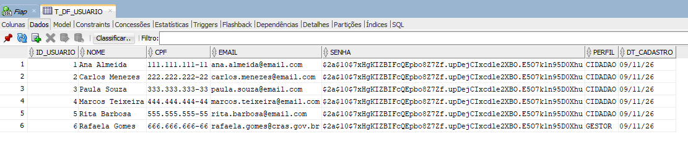 | 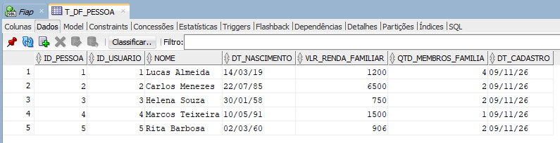 |
| `T_DF_DOCUMENTO` (5) | `T_DF_LAUDO` (5) |
|  |  |

`T_DF_DIREITO` (20 direitos):

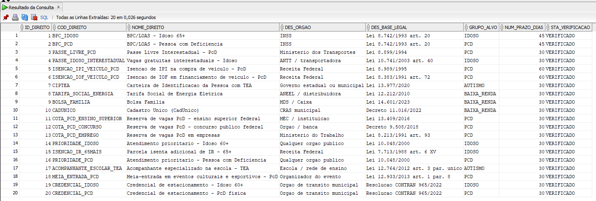

`T_DF_CRITERIO_DIREITO` (a regra em tabela):


`T_DF_CASO` (31 casos abertos pela procedure de avaliação):


`T_DF_AUDITORIA_CASO` (42 linhas gravadas pelo gatilho; a grade mostra as 41 primeiras e o resumo abaixo confirma 31 `INSERT` + 11 `UPDATE`):


`T_DF_ORIENTACAO` (vazia na carga; preenchida pela IA em tempo de execução):

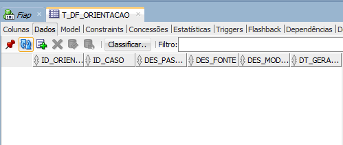

**Objetos criados** (14 tabelas, 4 pacotes com body, 8 procedures de carga e 2 gatilhos, todos `VALID`):


**Relatórios**

Relatório 1, direitos `ELEGIVEL` de Lucas Almeida:

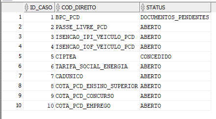

Relatório 2, casos em andamento com prazo até 05/12/2026:


Relatório 3 e totais:

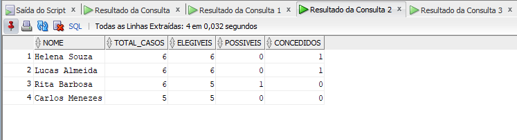
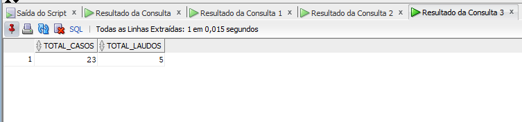

`PKG_CASOS.PRC_REL_CASOS_POR_STATUS`:

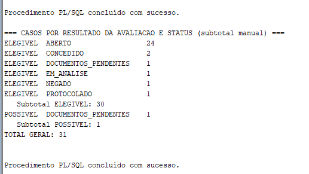

**Função, gatilhos e auditoria**

`FN_AVALIAR_ELEGIBILIDADE` para Rita Barbosa (`BPC_IDOSO` = `POSSIVEL`):

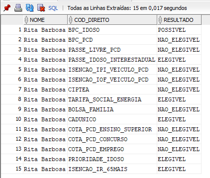

Gatilho de validação recusando `PROTOCOLADO` → `ABERTO` (`ORA-20033`):


Trilha de auditoria do caso 1 (3 linhas: a abertura e as duas mudanças de status da carga; a linha do teste 5 foi desfeita pelo `ROLLBACK`, e por isso os ids 32 e 33 vêm logo depois dos 31 inserts):


Banco intacto após o `ROLLBACK` do teste:

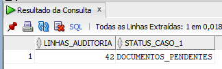

Regra da renda individual (teste 10 do `06`): Helena com 3 SM numa família de 4 tem 1,0796 SM per capita, mas o passe do idoso olha a renda individual (3,0228 SM) e fica `NAO_ELEGIVEL`:

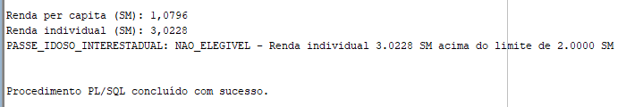

`T_DF_MEDICAMENTO_FP` (41 itens do elenco oficial do Farmácia Popular):

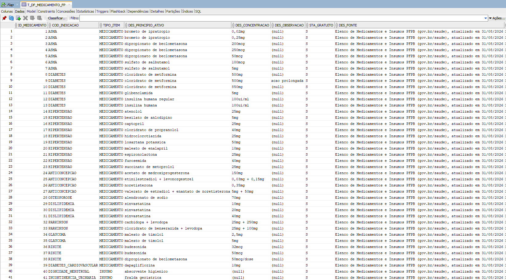

Teste 11 do `06`: receita de Helena com 4 remédios conferidos; a tabela decide o que é gratuito (2 de 4), e o item com dosagem diferente ou fora do elenco só recebe orientação para confirmar na farmácia:

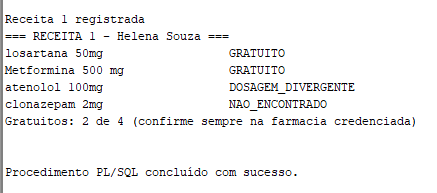

### 6.3 Evidências do MongoDB (MongoDB Compass, `_MONGOSH`)

Carga (`mongo/01_setup_e_carga.js`): 5 laudos e 31 casos, 36 documentos no total.

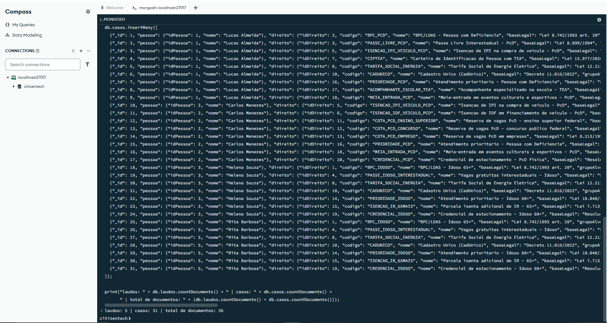

Relatório 1 (`find`): os 9 direitos `ELEGIVEL` de Lucas Almeida, igual ao relatório 1 do Oracle.

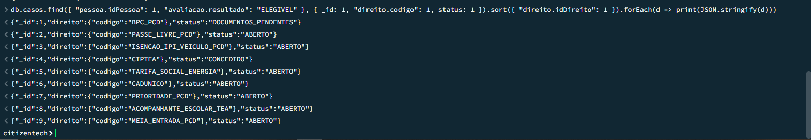

Relatório 2 (`find`): 22 casos em andamento com prazo até 05/12/2026, igual ao relatório 2 do Oracle.

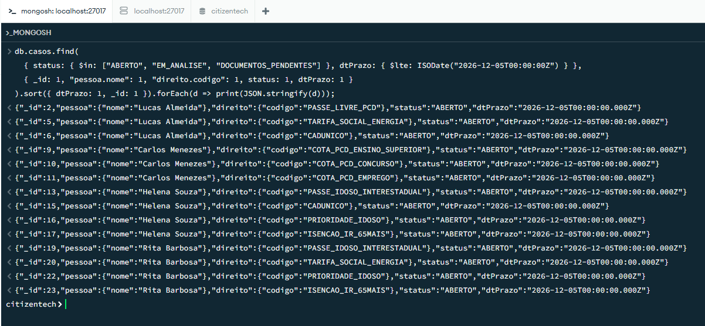

Relatório 3 (`aggregate`) e totais, idênticos ao relatório 3 do Oracle:


Database `citizentech` com as collections `casos` (31 documentos) e `laudos` (5):

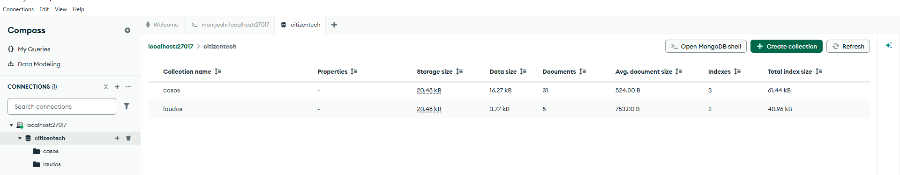

Nesses prints os relatórios 1 e 2 foram impressos com `print(JSON.stringify(d))`, um documento por linha, para caber em uma tela; os filtros e a ordenação são os mesmos de `mongo/02_consultas.js`.

---

## 7. Para o time de Java (JPA, JWT, RabbitMQ)

**Usuários de teste** (todos com a senha `Senha@123`, gravada como hash BCrypt em `T_DF_USUARIO.SENHA`):

| E-mail | Perfil (claim `role`) |
|---|---|
| ana.almeida@email.com (responsável por Lucas) | CIDADAO |
| carlos.menezes@email.com | CIDADAO |
| paula.souza@email.com (responsável por Helena) | CIDADAO |
| marcos.teixeira@email.com | CIDADAO |
| rita.barbosa@email.com | CIDADAO |
| rafaela.gomes@cras.gov.br (assistente social) | GESTOR |

**Mapeamento de tipos:** `ID_*` identity → `@GeneratedValue(strategy = GenerationType.IDENTITY)`; `NUMBER(10,2)`, `FRC_SM_MAX` e `PCT_TOLERANCIA` → `BigDecimal`; `DATE` → `LocalDateTime` (guardam hora); `CHAR(1)` S/N (`STA_EXIGE_PCD`, `STA_EXIGE_TEA`) → `boolean` com conversor; colunas de status e perfil → `enum` Java com os mesmos valores dos `CHECK`.

**Ligações JPA:** `Usuario 1─N Pessoa`, `Pessoa 1─N Documento`, `Pessoa 1─N Laudo`, `Documento 1─N Laudo` (opcional), `Pessoa 1─N Caso`, `Direito 1─N Caso`, `Direito 1─1 CriterioDireito`, `Caso 1─1 Orientacao`.

**Este banco é só do Java.** O banco da API .NET é outro e usa as migrations do próprio .NET: não há FK nem acesso direto entre os dois. A ligação é feita só por mensagem (RabbitMQ) e pelo `DES_ID_EXTERNO` do documento.

**Chamadas ao banco:** a regra decide no Oracle. Use `PKG_ELEGIBILIDADE.PRC_ABRIR_CASOS(p_id_pessoa, p_dt_ref)` para avaliar e abrir os casos, `PKG_ELEGIBILIDADE.FN_AVALIAR_ELEGIBILIDADE(p_id_pessoa, p_cod_direito, p_dt_ref)` para consultar, e `PKG_CASOS.PRC_ATUALIZAR_STATUS_CASO(p_id_caso, p_novo_status, p_dt_ref)` para mudar status e `PKG_CASOS.PRC_REGISTRAR_ORIENTACAO(p_id_caso, p_passo_a_passo, p_fonte, p_modelo)` para gravar (ou substituir) a orientação gerada pela IA. Para a Farmácia Popular: `PKG_FARMACIA_POPULAR.PRC_REGISTRAR_RECEITA(p_id_pessoa, p_id_documento, p_id_receita OUT)` e, para cada remédio já conferido pela pessoa, `PKG_FARMACIA_POPULAR.PRC_ADICIONAR_ITEM(p_id_receita, p_nome_lido, p_principio, p_concentracao, p_corrigido)`. `p_dt_ref` pode ser omitido (usa `SYSDATE`) com `StoredProcedureQuery` ou `SimpleJdbcCall`.

**Erros do banco para o `@RestControllerAdvice`:**

| Erro Oracle | Significado | HTTP sugerido |
|---|---|---|
| `ORA-20022` | pessoa, direito ou critério não encontrado | 404 |
| `ORA-20023` | código de direito inexistente | 404 |
| `ORA-20040` / `ORA-20041` | caso não encontrado (ao mudar status / ao gravar orientação) | 404 |
| `ORA-20031` | caso novo precisa nascer `ABERTO` | 422 |
| `ORA-20032` | caso `CONCEDIDO`/`NEGADO` não muda mais | 409 |
| `ORA-20033` | transição de status inválida | 409 |
| `ORA-20034` | prazo anterior à abertura | 422 |
| `ORA-20060` | pessoa não encontrada ao registrar receita | 404 |
| `ORA-20061` | receita não encontrada ao adicionar item ou gerar relatório | 404 |
| `ORA-00001` em `UK_DF_CASO_PESSOA_DIREITO` | caso duplicado | 409 |
| `ORA-00001` em `UK_DF_DOCUMENTO_IDEM` ou `UK_DF_DOCUMENTO_EXT` | evento/documento repetido (idempotência) | ignorar o evento ou 200 com o registro já existente |
| `ORA-00001` em `UK_DF_USUARIO_CPF` / `_EMAIL` | cadastro duplicado | 409 |

**Flyway:** copie `flyway/V1` a `V5` para `src/main/resources/db/migration` (com `spring.jpa.hibernate.ddl-auto=validate`). Foram testadas num schema Oracle limpo. `V5` abre os casos da demo; remova se o ambiente não deve ter dados de demonstração.

**Eventos RabbitMQ (previstos no documento do projeto):** `DocumentoRecebido` (o .NET publica; o Java grava em `T_DF_DOCUMENTO` com status `RECEBIDO` e depois `PROCESSADO`, usando a chave de idempotência para não duplicar), `DireitoIdentificado` (após `PRC_ABRIR_CASOS`), `PrazoVencendo` e `CasoParado` (consultas por `DT_PRAZO` e `DT_ATUALIZACAO` em `T_DF_CASO`).

**App mobile (consome a API Java, nunca o banco):** tudo que as telas precisam já existe no banco. O envio da foto do laudo vai para a API .NET, que avisa o Java pelo evento `DocumentoRecebido`.

| Tela | Dados |
|---|---|
| Login | `T_DF_USUARIO` (e-mail, hash BCrypt, `PERFIL`) |
| Meus familiares e laudos | `T_DF_PESSOA`, `T_DF_LAUDO`, `T_DF_DOCUMENTO` (status do envio) |
| Direitos encontrados | `T_DF_CASO` (`RESULTADO_AVALIACAO`, `DES_MOTIVO`, `STATUS`, `DT_PRAZO`) + `T_DF_DIREITO` (nome, órgão, base legal) |
| Detalhe do caso | `T_DF_ORIENTACAO` (passo a passo e fonte) e o histórico de status em `T_DF_AUDITORIA_CASO` |
| Farmácia Popular | `T_DF_RECEITA` e `T_DF_RECEITA_ITEM` (resultado e orientação por remédio); a tela de conferência da leitura da IA vem antes de chamar `PRC_ADICIONAR_ITEM` |
| Painel do assistente social (`GESTOR`) | casos por prazo e por status (`07_RELATORIOS_ORACLE.sql` e `PRC_REL_CASOS_POR_STATUS`) |

---

## 8. Status e pendências

- **Oracle:** os scripts `00` a `08` foram executados na ordem no Oracle SQL Developer, sem erros de compilação, e os resultados batem com as seções 5 e 6.1 (evidências na seção 6.2). Os mesmos scripts e as migrations do `flyway/` também foram validados do zero em Oracle Free (23ai) via SQL*Plus; nesse cliente use `SET SQLBLANKLINES ON` (o SQL Developer não precisa).
- **MongoDB:** os scripts `mongo/01_setup_e_carga.js` e `mongo/02_consultas.js` foram executados no MongoDB (Compass, `_MONGOSH`); a carga criou 2 collections com 36 documentos e os resultados dos relatórios batem com os do Oracle (seção 5). O Mongo guarda as datas em UTC (`2026-11-05T00:00:00Z`) e o `DATE` do Oracle não tem fuso, o que não altera nenhum resultado.
- **Catálogo de direitos:** os valores e as regras abaixo foram conferidos em 09 e 10/11/2026 em páginas oficiais (gov.br e planalto.gov.br). Os **20 direitos** estão com `STA_VERIFICACAO = 'VERIFICADO'`. Isso significa que a regra do banco foi comparada com a fonte oficial abaixo; as escolhas do projeto que a lei não define (idades mínimas e máxima, a tolerância de 20%, o que o banco não modela) estão nas ressalvas. A coluna continua aceitando `CONFIRMAR` para direitos futuros.

| Item no banco | Regra | Status | Fonte oficial |
|---|---|---|---|
| Salário mínimo 2026 | R$ 1.621,00 (2025: R$ 1.518,00, Decreto 12.342/2024) | Conferido | [Decreto 12.797/2025 (Planalto)](https://www.planalto.gov.br/ccivil_03/_ato2023-2026/2025/decreto/d12797.htm) |
| `BPC_IDOSO` e `BPC_PCD` | até 1/4 do SM per capita (R$ 405,25) | `VERIFICADO` | [INSS: regras do BPC](https://www.gov.br/inss/pt-br/noticias/nao-caia-em-informacao-falsa-sobre-regras-do-bpc) |
| `TARIFA_SOCIAL_ENERGIA` | até 1/2 SM per capita (CadÚnico) | `VERIFICADO` | [Lei 12.212/2010 (Planalto)](http://www.planalto.gov.br/ccivil_03/_ato2007-2010/2010/lei/l12212.htm) e [ANEEL](https://www.gov.br/aneel/pt-br/assuntos/noticias/2025/tarifa-social-movimenta-mais-de-6-bilhoes-em-descontos-em-2024-para-familias-carentes) |
| `CADUNICO` | até 1/2 SM per capita (art. 5º, II) | `VERIFICADO` | [Decreto 11.016/2022 (Planalto)](https://www.planalto.gov.br/ccivil_03/_ato2019-2022/2022/decreto/d11016.htm) |
| `PASSE_LIVRE_PCD` | PcD com renda até 1 SM per capita | `VERIFICADO` | [gov.br: Passe Livre Interestadual](https://www.gov.br/pt-br/servicos/obter-passe-livre-interestadual-digital) e [Ministério dos Transportes](https://www.gov.br/transportes/pt-br/servicos/servicos/passe-livre) |
| `PASSE_IDOSO_INTERESTADUAL` | 60+ com renda **individual** de até 2 SM (art. 40, I) | `VERIFICADO` | [Estatuto da Pessoa Idosa (PDF do MDS)](https://www.mds.gov.br/webarquivos/publicacao/assistencia_social/Normativas/Estatuto_Idoso.pdf) |
| `ISENCAO_IPI_VEICULO_PCD` | PcD (física, visual, auditiva, mental grave) ou TEA | `VERIFICADO` | [Lei 8.989/1995 (Planalto)](https://www.planalto.gov.br/ccivil_03/leis/l8989compilado.htm) e [Receita Federal](https://www.gov.br/receitafederal/pt-br/acesso-a-informacao/perguntas-frequentes/isencao-para-compra-de-carro/isencao-para-compra-de-carro) |
| `ISENCAO_IOF_VEICULO_PCD` | só deficiência física, condutor com CNH (18+) | `VERIFICADO` | [Lei 8.383/1991, art. 72 (Planalto)](https://www.planalto.gov.br/ccivil_03/leis/l8383.htm) e [Receita Federal](https://www.gov.br/receitafederal/pt-br/acesso-a-informacao/perguntas-frequentes/isencao-para-compra-de-carro/isencao-para-compra-de-carro) |
| `CIPTEA` | laudo de TEA | `VERIFICADO` | [Lei 13.977/2020 (Planalto)](https://www.planalto.gov.br/ccivil_03/_ato2019-2022/2020/lei/l13977.htm) |
| `PRIORIDADE_IDOSO` e `PRIORIDADE_PCD` | 60 anos ou mais; pessoa com deficiência | `VERIFICADO` | [Lei 10.048/2000 (Planalto)](https://www.planalto.gov.br/ccivil_03/leis/l10048.htm) |
| `COTA_PCD_CONCURSO` | PcD, mínimo 5% das vagas; idade mínima 18 | `VERIFICADO` | [Decreto 9.508/2018 (Planalto)](https://planalto.gov.br/CCiViL_03/_Ato2015-2018/2018/Decreto/D9508.htm) e [MGI](https://www.gov.br/gestao/pt-br/assuntos/acoes-afirmativas-na-gestao-1/reserva-de-vagas-para-pessoas-com-deficiencia-em-concursos-publicos) |
| `COTA_PCD_EMPREGO` | empresas com 100+ empregados reservam 2% a 5%; idade mínima 16 | `VERIFICADO` | [Lei 8.213/1991, art. 93 (Planalto)](https://www.planalto.gov.br/ccivil_03/leis/l8213cons.htm) |
| `COTA_PCD_ENSINO_SUPERIOR` | PcD; reserva por curso e turno nas instituições federais; a lei não fixa idade (16 é escolha do projeto) | `VERIFICADO` | [Lei 13.409/2016, que altera a Lei 12.711 (Planalto)](https://www.planalto.gov.br/ccivil_03/_ato2015-2018/2016/lei/l13409.htm) |
| `BOLSA_FAMILIA` | até R$ 218 por pessoa da família, inscrita no CadÚnico (guardado como 0,1345 SM = R$ 218,03 com o SM de 2026) | `VERIFICADO` | [MDS: conheça as regras ("renda mensal por pessoa da família de até R$ 218")](https://www.gov.br/mds/pt-br/acoes-e-programas/bolsa-familia/paginas/conheca-as-regras) |
| `ISENCAO_IR_65MAIS` | 65+: parcela isenta adicional sobre aposentadoria e pensão, a partir do mês em que completa 65 anos | `VERIFICADO` | [Receita Federal: isenção 65+](https://www.gov.br/receitafederal/pt-br/assuntos/meu-imposto-de-renda/preenchimento/isencao65) e [Lei 15.270/2025 (Planalto)](https://www.planalto.gov.br/ccivil_03/_ato2023-2026/2025/lei/l15270.htm), que não altera o art. 6º, XV, da Lei 7.713/1988 |
| `ACOMPANHANTE_ESCOLAR_TEA` | TEA em classe comum de ensino regular, com comprovada necessidade; a lei não fixa idade (até 17 é escolha do projeto) | `VERIFICADO` | [Lei 12.764/2012, art. 3º, parágrafo único (Planalto)](https://www.planalto.gov.br/ccivil_03/_ato2011-2014/2012/lei/l12764.htm) |
| `MEIA_ENTRADA_PCD` | pessoa com deficiência (e acompanhante quando necessário), sem exigência de renda | `VERIFICADO` | [Lei 12.933/2013, art. 1º, § 8º (Planalto)](https://www.planalto.gov.br/ccivil_03/_ato2011-2014/2013/lei/l12933.htm) |
| `CREDENCIAL_IDOSO` | 60+; credencial emitida pelo órgão de trânsito do município, validade de 5 anos | `VERIFICADO` | [Estatuto da Pessoa Idosa, arts. 1º e 41 (Planalto)](https://www.planalto.gov.br/ccivil_03/leis/2003/l10.741.htm) e [Resolução CONTRAN 965/2022, arts. 3º, 12 e 13](https://www.normasbrasil.com.br/norma/resolucao-965-2022_431903.html) |
| `CREDENCIAL_PCD` | pessoa com deficiência com comprometimento de mobilidade (o banco usa o laudo `DEF_FISICA` como aproximação); validade de 5 anos se permanente | `VERIFICADO` | [Resolução CONTRAN 965/2022, arts. 3º, II, 12 e 13](https://www.normasbrasil.com.br/norma/resolucao-965-2022_431903.html) |

Ressalvas: (1) o `POSSIVEL` (tolerância de 20% sobre o limite) é uma escolha do projeto para sinalizar renda próxima do limite; o BPC pode ser concedido acima de 1/4 SM com prova de vulnerabilidade, mas isso exige análise caso a caso; (2) a isenção de IOF vale só para deficiência física e exige CNH; por isso o banco usa o tipo de deficiência exigido (`COD_TIPO_EXIGIDO`) e idade mínima 18, e Lucas (7 anos, TEA) não é elegível; (3) as idades mínimas das cotas (18 para concurso, 16 para emprego e ensino superior) e a idade máxima de 17 do acompanhante escolar são regras práticas do projeto, pois a lei não as fixa; a cota de ensino superior também pode depender de o candidato ter cursado o ensino médio em escola pública, o que o banco não modela; (4) segundo a Receita, o benefício de IPI para PcD está garantido até 31/12/2026, e a isenção exige laudo assinado por médico (e, no caso de autismo, também por psicólogo); (5) o Bolsa Família exige inscrição no CadÚnico e a entrada depende de orçamento disponível; o banco só compara a renda per capita; (6) a isenção de IR 65+ só vale sobre aposentadoria e pensão, e o banco não registra a origem da renda (só a idade); o valor mensal da parcela está na tabela da Receita (IN RFB 1.500/2014, Anexo I) e não é guardado no banco; (7) a credencial de estacionamento exige comprometimento de mobilidade; o banco usa o laudo `DEF_FISICA` como aproximação, e a emissão depende do órgão de trânsito do município; (8) o passe do idoso usa a **renda individual** e não a per capita, porque a lei fala em renda da pessoa; (9) as normas mudam com frequência; reconfira antes de usar em produção.
- Dados, pessoas e laudos são **fictícios**.

## 9. Uso de IA generativa (declaração exigida pelo PDF da Global Solution)

Ferramenta: **Claude (Anthropic)**, usada como apoio para gerar o rascunho dos scripts SQL e deste README, a partir dos requisitos da disciplina e do padrão da entrega anterior (CLYVO VET). O código SQL e JavaScript foi executado e os resultados conferidos pelo integrante responsável pelo banco, conforme as evidências da seção 6.2.

## 10. Integrantes

| RM | Nome completo | Turma |
|---|---|---|
| RM565594 | João Vitor Biribilli Ravelli | 2TDSPG |
| RM564093 | Gabriel Neris Losano | 2TDSPG |
| RM565554 | Alexander Dennis Isidro Mamani | 2TDSPG |
| RM563748 | Kelson Zhang | 2TDSPG |
| RM561378 | Pietro Paranhos Wilhelm | 2TDSPG |
