# Direito Fácil — Banco de Dados (Oracle PL/SQL + MongoDB)

Global Solution 2026/2 · CitizenTech · 2TDSPG
Disciplina: **Mastering Relational and Non-Relational Database**
Entrega: 19/11/2026, até 23h55 (Portal do Aluno)

> **Status deste repositório:** as partes **Oracle** e **MongoDB** estão completas, executadas e documentadas com prints (seções 6.2 e 6.3 e `documentacaoDB.pdf`).

---

## 1. Problema CitizenTech

Famílias de pessoas com autismo, deficiência ou idosas de baixa renda não sabem **a quais direitos federais o laudo médico dá acesso**, nem em que ponto cada pedido está parado. O app lê o laudo, confere cada direito do catálogo e acompanha cada pedido (caso) até a concessão.

**Princípio: "a regra decide, a IA explica".** Quem decide se a pessoa é `ELEGIVEL`, `POSSIVEL` ou `NAO_ELEGIVEL` é o **Oracle (PL/SQL)**, a partir de critérios guardados em tabela (frações do salário mínimo). A IA (Spring AI) só extrai dados do laudo e explica o passo a passo. Por isso a decisão é determinística, testável e auditável.

ODS: 3 (Saúde e bem-estar), 10 (Redução das desigualdades), 11 (Cidades e comunidades sustentáveis).

Base legal usada na regra de TEA: Lei 12.764/2012, art. 1º, §2º — a pessoa com TEA é considerada pessoa com deficiência (PcD) para todos os efeitos legais. Por isso um laudo de autismo abre direitos de PcD (`TIPO_CONDICAO = 'TEA'` conta como PcD na função de elegibilidade).

---

## 2. Ordem de execução

### Oracle (SQL Developer, schema do aluno; feche abas antigas e rode direto do disco)

| # | Arquivo | O que faz | Requisito do PDF |
|---|---|---|---|
| 0 | `00_DROP.sql` | Reset completo (opcional, seguro de rodar duas vezes) | — |
| 1 | `01_DDL.sql` | 11 tabelas em 3FN, PK/FK/UK/CHECK | 2+ tabelas relacionadas |
| 2 | `02_PROCEDURES.sql` | 7 procedures de carga (`PRC_CARGA_*`) com log de erro | — |
| 3 | `03_CARGA.sql` | Dados de teste: 6 usuários, 5 pessoas, 5 documentos, 5 laudos, 15 direitos, 15 critérios | dados de teste |
| 4 | `04_BLOCOS_PLSQL.sql` | **2 blocos anônimos**: cursor + `FOR LOOP` + `IF/ELSIF`; `WHILE` + `CASE` | 2 blocos PL/SQL |
| 5 | `05_FUNCOES_PROCEDURES_GATILHOS.sql` | **2 funções + 3 procedures + 2 gatilhos**, abre os casos e roda os testes | funções, procedures, gatilhos |
| 6 | `06_PACKAGES.sql` | **3 pacotes** (spec + body) + gatilho de auditoria delegando ao pacote + testes | 2+ pacotes com testes |
| 7 | `07_RELATORIOS_ORACLE.sql` | 3 relatórios equivalentes às consultas do MongoDB | comparação |
| 8 | `08_EXPORTA_JSON.sql` | (opcional) exporta os casos como JSON montado à mão | transição |

### Arquivos deste repositório

| Item | O que é |
|---|---|
| `00_DROP.sql` a `08_EXPORTA_JSON.sql` | Scripts Oracle, na ordem de execução |
| `mongo/` | Scripts MongoDB: carga de 2 collections (32 documentos) e as 3 consultas |
| `flyway/` | O mesmo banco em migrations `V1` a `V5`, sem comandos de SQL*Plus, para a API Java |
| `evidencias/` | Prints da execução no Oracle SQL Developer |
| `documentacaoDB.pdf` | Documentação com os requisitos atendidos e todas as evidências |

### MongoDB (mongosh ou Compass → `_MONGOSH`)

| # | Arquivo | O que faz |
|---|---|---|
| 1 | `mongo/01_setup_e_carga.js` | Seleciona/cria o database `citizentech`, cria 2 collections (com validação e índices), insere **32 documentos** |
| 2 | `mongo/02_consultas.js` | 2 `find` + 1 `aggregate`, equivalentes aos relatórios do Oracle |

```bash
mongosh "mongodb://localhost:27017" --file mongo/01_setup_e_carga.js
mongosh "mongodb://localhost:27017" --file mongo/02_consultas.js
```

Há ainda a pasta `flyway/` (`V1` a `V5`), com o mesmo banco sem comandos de SQL*Plus, para o time de Java copiar para `src/main/resources/db/migration` (seção 7).

Todos os scripts são reexecutáveis. Datas dos testes são fixas (`05/11/2026`) para o resultado ser sempre o mesmo.

---

## 3. Modelo Oracle

```
T_DF_USUARIO (1) ──< T_DF_PESSOA (1) ──< T_DF_DOCUMENTO (1) ──< T_DF_LAUDO
                            │            (também 1 ──< T_DF_LAUDO pela pessoa)
                            │
                            └──< T_DF_CASO >── (N) T_DF_DIREITO (1) ── (1) T_DF_CRITERIO_DIREITO
                                     │
                                     └── (via gatilho) T_DF_AUDITORIA_CASO

T_DF_SALARIO_MINIMO  (parâmetro de renda)      T_DF_LOG_ERRO  (erros das procedures)
```

| Tabela | Papel |
|---|---|
| `T_DF_USUARIO` | Login do app: perfil `CIDADAO` ou `GESTOR` (vira a role do JWT) |
| `T_DF_PESSOA` | Beneficiário (idade, renda familiar, nº de membros) acompanhado por um usuário responsável |
| `T_DF_DOCUMENTO` | Registro, **neste banco**, de cada documento de laudo anunciado pelo evento `DocumentoRecebido`: metadados e `DES_ID_EXTERNO` (id do documento na API .NET, **sem FK**, pois os bancos são independentes). `DES_CHAVE_IDEMPOTENCIA` é única: se o RabbitMQ entregar o mesmo evento duas vezes, o Java não cria um segundo registro. Status `RECEBIDO`, `PROCESSADO` ou `ERRO` |
| `T_DF_ORIENTACAO` | Passo a passo em linguagem simples gerado pela IA (RAG) e gravado pelo Java, com a **fonte citada** (lei ou cartilha). 1:1 com o caso; o app mobile lê pela API |
| `T_DF_LAUDO` | Dados estruturados do laudo (ligado ao documento): CID, condição, `TIPO_CONDICAO` (`TEA`, `DEF_FISICA`, …, `OUTRA`) |
| `T_DF_DIREITO` | Catálogo de 15 direitos federais (órgão, base legal, prazo, `STA_VERIFICACAO`) |
| `T_DF_CRITERIO_DIREITO` | **A regra em tabela**: idade mín/máx, exige PcD, exige TEA, fração do SM per capita, tolerância |
| `T_DF_CASO` | Pedido de um direito: status, resultado da avaliação, motivo, prazo. `UNIQUE(pessoa, direito)` |
| `T_DF_AUDITORIA_CASO` | Trilha: usuário, data, operação, status/valores antigo e novo |
| `T_DF_SALARIO_MINIMO` | Valor do salário mínimo por ano |
| `T_DF_LOG_ERRO` | Toda procedure grava aqui quando cai em `EXCEPTION` |

### Regra de elegibilidade (`FN_AVALIAR_ELEGIBILIDADE` → `PRC_AVALIAR_DIREITO`)

Avalia na ordem e para na primeira falha:

1. Idade fora da faixa → `NAO_ELEGIVEL`
2. Direito exige TEA e não há laudo de TEA → `NAO_ELEGIVEL`
3. Direito exige PcD e não há laudo de deficiência (TEA conta) → `NAO_ELEGIVEL`
4. Sem limite de renda → `ELEGIVEL`
5. Renda per capita (em SM) ≤ limite → `ELEGIVEL`
6. Até o limite + tolerância (padrão 20%) → `POSSIVEL` ("confirmar renda no CadÚnico")
7. Acima → `NAO_ELEGIVEL`

`PRC_ABRIR_CASOS` percorre o catálogo com cursor e abre um caso para cada direito `ELEGIVEL` ou `POSSIVEL` (não duplica).

### Gatilhos

| Gatilho | Tipo | O que faz |
|---|---|---|
| `TRG_DF_CASO_VALIDA` | `BEFORE INSERT OR UPDATE` | Caso nasce `ABERTO`; prazo ≥ abertura; fluxo de status (`PROTOCOLADO` só vai para `CONCEDIDO`/`NEGADO`; estados finais não mudam) |
| `TRG_DF_AUDITORIA_CASO` | `AFTER INSERT OR UPDATE OR DELETE` | **Trilha de auditoria** com data, operação, `:OLD`/`:NEW` |

### Pacotes (06)

| Pacote | Conteúdo |
|---|---|
| `PKG_ELEGIBILIDADE` | `FN_RENDA_PER_CAPITA_SM`, `PRC_AVALIAR_DIREITO`, `FN_AVALIAR_ELEGIBILIDADE`, `PRC_ABRIR_CASOS` |
| `PKG_CASOS` | `PRC_ATUALIZAR_STATUS_CASO`, `PRC_REGISTRAR_ORIENTACAO`, `FN_CASO_TO_JSON`, `PRC_EXPORTA_CASOS_JSON`, `PRC_REL_CASOS_POR_STATUS` |
| `PKG_AUDITORIA` | `REGISTRAR_AUDITORIA_CASO` — o Oracle não aceita gatilho dentro de pacote, então o gatilho virou uma casca fina que delega ao pacote |

As funções/procedures do `05` (avulsas) são movidas para os pacotes no `06` e dropadas, igual ao padrão da entrega anterior.

---

## 4. Mapeamento relacional → documental (Oracle → MongoDB)
Não há integração automática: a transição é demonstrada por scripts. O `FN_CASO_TO_JSON` mostra como cada caso do Oracle vira um documento.

| Oracle | MongoDB | Como |
|---|---|---|
| `T_DF_LAUDO` + `T_DF_PESSOA` + `T_DF_DOCUMENTO` | collection **`laudos`** | `ID_LAUDO` → `_id`; pessoa e documento **embutidos** (snapshot); texto bruto e metadados da IA só existem no Mongo |
| `T_DF_CASO` + `T_DF_DIREITO` + `T_DF_AUDITORIA_CASO` | collection **`casos`** | `ID_CASO` → `_id`; direito **embutido**; histórico de status **embutido** como array; pessoa por **referência** (`idPessoa`) + nome |
| `T_DF_CRITERIO_DIREITO`, `T_DF_USUARIO`, `T_DF_SALARIO_MINIMO`, `T_DF_ORIENTACAO`, `T_DF_LOG_ERRO` | não migradas (a orientação é gerada pela IA em tempo de execução e não faz parte da carga) | são regra e infraestrutura: ficam no Oracle |
| `UK_DF_CASO_PESSOA_DIREITO` | índice único `{pessoa.idPessoa, direito.idDireito}` | mesma garantia |
| `CK_DF_CASO_STATUS` | `$jsonSchema` com `enum` | mesma garantia |

### Por que embutir e por que referenciar

- **Embutido — direito dentro do caso:** o caso sempre é lido junto com o nome e a base legal do direito, e o direito tem poucas alterações. Guardar uma cópia dá uma tela de caso com 1 leitura, sem join. É um snapshot do que valia na abertura do caso.
- **Embutido — histórico dentro do caso:** são poucas linhas (1 a 4) que só fazem sentido dentro do caso. No Oracle isso é a tabela de auditoria.
- **Embutido — pessoa e documento dentro do laudo:** o laudo é um documento extraído num momento; a idade, a renda e os dados do arquivo recebido são o retrato daquele momento, e o documento tem relação 1:1 com o laudo.
- **Referência — pessoa no caso:** uma pessoa tem muitos casos (até 10 na demo) e seus dados mudam. Copiar tudo em cada caso geraria dado duplicado e desatualizado, então o caso guarda só `idPessoa` + `nome` (para exibir listas).
- **Fica no Oracle:** critérios e decisão. A regra precisa ser única, transacional e auditável.

---

## 5. Os 3 relatórios (Oracle × MongoDB) — resultado esperado

Com os dados da carga, os dois bancos devem devolver exatamente isto.

### Relatório 1 — direitos `ELEGIVEL` de Lucas Almeida (`find` × `SELECT … JOIN`)

| ID_CASO | Direito | Status |
|---|---|---|
| 1 | BPC_PCD | DOCUMENTOS_PENDENTES |
| 2 | PASSE_LIVRE_PCD | ABERTO |
| 3 | ISENCAO_IPI_VEICULO_PCD | ABERTO |
| 4 | ISENCAO_IOF_VEICULO_PCD | ABERTO |
| 5 | CIPTEA | CONCEDIDO |
| 6 | TARIFA_SOCIAL_ENERGIA | ABERTO |
| 7 | CADUNICO | ABERTO |
| 8 | COTA_PCD_ENSINO_SUPERIOR | ABERTO |
| 9 | COTA_PCD_CONCURSO | ABERTO |
| 10 | COTA_PCD_EMPREGO | ABERTO |

### Relatório 2 — casos em andamento com prazo até 05/12/2026 (`find` × `SELECT … WHERE`)

**17 linhas**, ordenadas por prazo e id: casos 2, 6, 7, 8, 9, 10 (Lucas), 13, 14, 15 (Carlos), 17, 19, 20, 21 (Helena), 23, 24, 26, 27 (Rita), todos com prazo 2026-12-05 e status `ABERTO`. Casos com status `PROTOCOLADO`, `CONCEDIDO` ou `NEGADO` não entram, e os de 45 dias (BPC) vencem só em 20/12.

### Relatório 3 — panorama por pessoa (`aggregate` × `GROUP BY`)

| Pessoa | Total | Elegíveis | Possíveis | Concedidos |
|---|---|---|---|---|
| Lucas Almeida | 10 | 10 | 0 | 1 |
| Helena Souza | 6 | 6 | 0 | 1 |
| Rita Barbosa | 6 | 5 | 1 | 0 |
| Carlos Menezes | 5 | 5 | 0 | 0 |

Totais: **27 casos**, **5 laudos** e **5 documentos** (32 documentos no Mongo, já que o documento fica embutido no laudo). Marcos Teixeira não aparece: não tem nenhum direito elegível (teste negativo).

### Personas e casos de teste

| Pessoa | Per capita (SM) | Resultado |
|---|---|---|
| Lucas, 7 anos, autismo, baixa renda | 0,1851 | 10 direitos `ELEGIVEL`; `BOLSA_FAMILIA` fica `NAO_ELEGIVEL` (acima do limite + tolerância) |
| Carlos, cadeirante, renda média | 2,0049 | 5 direitos sem limite de renda; `BPC_PCD` e `PASSE_LIVRE_PCD` `NAO_ELEGIVEL` |
| Helena, 68 anos, baixa renda | 0,2313 | 6 direitos de idoso/baixa renda `ELEGIVEL`; laudo `OUTRA` não abre PcD |
| Marcos, 35 anos, sem deficiência | 0,9254 | nenhum direito (teste negativo) |
| Rita, 66 anos, renda no limite | 0,2795 | `BPC_IDOSO` = `POSSIVEL` (dentro da tolerância de 20%); demais `ELEGIVEL` |

---

## 6. Para a apresentação (30 pts)

1. Explicar o problema e o modelo → seções 1 e 3
2. Executar função e procedure → `05`, teste 1 (matriz) e teste 2 (motivo)
3. Gatilho, auditoria e pacotes → `05` testes 4 e 5; `06` testes 5 a 7
4. Criar collections e inserir documentos → `mongo/01_setup_e_carga.js`
5. 3 relatórios e comparação → `07_RELATORIOS_ORACLE.sql` × `mongo/02_consultas.js`
6. Justificar a transição → seção 4

### 6.1 Como testar no Oracle SQL Developer

1. Abra uma conexão com o schema de vocês e habilite `View > DBMS Output` (aba Output, botão `+`, escolha a conexão).
2. Abra cada arquivo `.sql` da raiz do repositório pelo `File > Open`, na ordem (`00` a `08`), e rode com **F5** (Run Script). Veja o resultado na aba **Script Output**.
3. Confira estes pontos:

| Arquivo | O que deve aparecer |
|---|---|
| `03_CARGA` | Tabela final com USUARIO 6, PESSOA 5, DOCUMENTO 5, LAUDO 5, DIREITO 15, CRITERIO_DIREITO 15 e **LOG_ERRO 0** |
| `04_BLOCOS_PLSQL` | 5 pessoas com faixa etária e renda; 5 laudos com "Total PcD: 2 (sendo TEA: 1) \| Sem deficiencia: 3" |
| `05` | Matriz de elegibilidade (45 linhas); `POSSIVEL - Renda per capita 0.2795 SM proxima do limite de 0.2500 SM...`; `NAO_ELEGIVEL - Exige laudo de deficiencia (PcD)`; `Erro tratado: ORA-20023`; `Erro tratado: ORA-20032`; `Erro: Documento ja registrado (id externo ou chave de idempotencia repetidos)`; `DOCUMENTOS_COM_A_CHAVE = 1` |
| `06` | `Orientacao registrada para o caso 1` (2 vezes) e `Erro tratado: ORA-20041`; `Helena x BPC_IDOSO: ELEGIVEL`; `Pessoa 1: 0 caso(s) aberto(s)`; relatório com `TOTAL GERAL: 27`; o JSON do caso 1; `Erro tratado: ORA-20033`; 4 linhas de auditoria do caso 1; `Rollback complete.` |
| `07` | 10, 17 e 4 linhas e totais 27 e 5 |

Se algum script falhar, confira a mensagem na aba **Script Output**. Para refazer tudo do zero, rode `00_DROP.sql` e depois os demais em ordem (rodar `01` a `03` duas vezes sem o `00` gera erro de objeto já existente e de chave duplicada).

### 6.2 Evidências de execução (Oracle SQL Developer)

Os prints abaixo foram tirados após rodar os scripts na ordem. O PDF `documentacaoDB.pdf` traz as mesmas imagens com legendas.

**Tabelas e carga**

| | |
|---|---|
| `T_DF_USUARIO` (6) | `T_DF_PESSOA` (5) |
|  |  |
| `T_DF_DOCUMENTO` (5) | `T_DF_LAUDO` (5) |
| 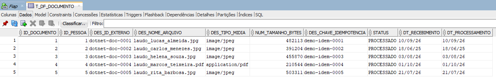 | 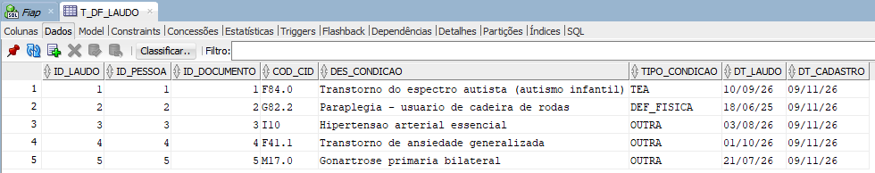 |

`T_DF_DIREITO` (15 direitos):


`T_DF_CRITERIO_DIREITO` (a regra em tabela):

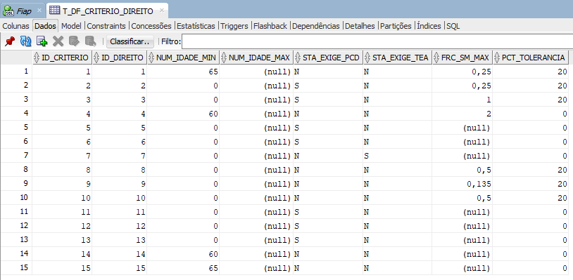

`T_DF_CASO` (27 casos abertos pela procedure de avaliação):

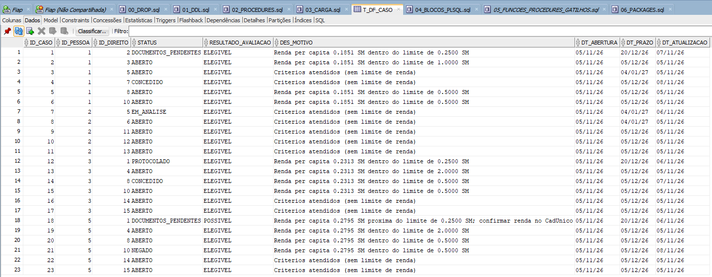

`T_DF_AUDITORIA_CASO` (38 linhas gravadas pelo gatilho):

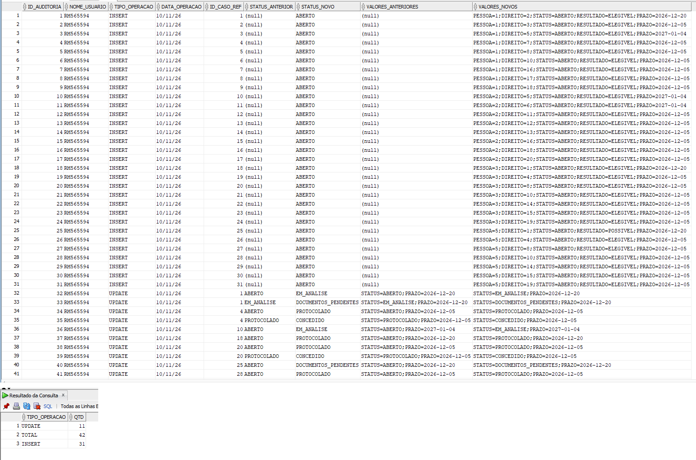

`T_DF_ORIENTACAO` (vazia na carga; preenchida pela IA em tempo de execução):


**Objetos criados** (11 tabelas, 3 pacotes com body, 7 procedures de carga e 2 gatilhos, todos `VALID`):

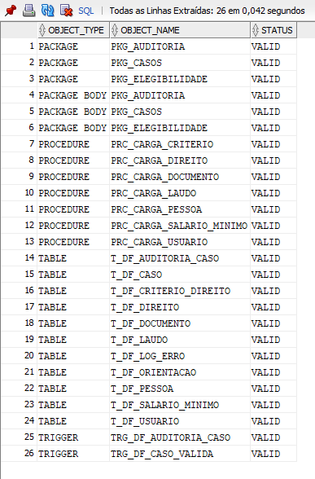

**Relatórios**

Relatório 1, direitos `ELEGIVEL` de Lucas Almeida:


Relatório 2, casos em andamento com prazo até 05/12/2026:

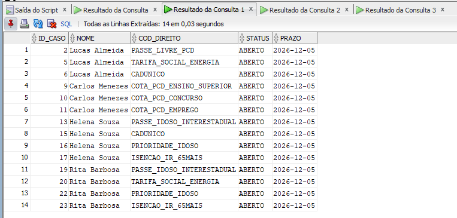

Relatório 3 e totais:


`PKG_CASOS.PRC_REL_CASOS_POR_STATUS`:


**Função, gatilhos e auditoria**

`FN_AVALIAR_ELEGIBILIDADE` para Rita Barbosa (`BPC_IDOSO` = `POSSIVEL`):


Gatilho de validação recusando `PROTOCOLADO` → `ABERTO` (`ORA-20033`):

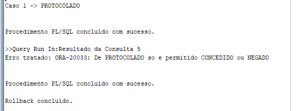

Trilha de auditoria do caso 1 (o id 42 aparece porque colunas identity não voltam atrás no `ROLLBACK`):

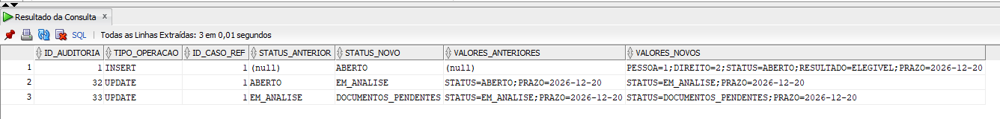

Banco intacto após o `ROLLBACK` do teste:


### 6.3 Evidências do MongoDB (MongoDB Compass, `_MONGOSH`)

Carga (`mongo/01_setup_e_carga.js`): 5 laudos e 27 casos, 32 documentos no total.

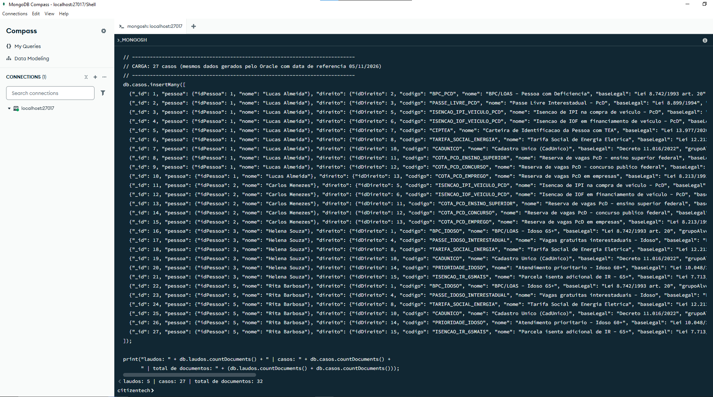

Relatório 3 (`aggregate`) e totais (`mongo/02_consultas.js`), idênticos ao relatório 3 do Oracle:

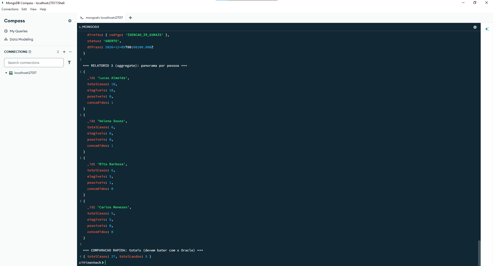

Database `citizentech` com as collections `casos` (27 documentos) e `laudos` (5):

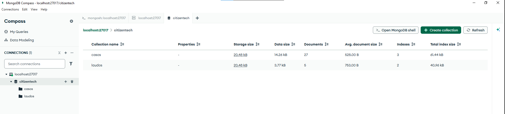

---

## 7. Para o time de Java (JPA, JWT, RabbitMQ)

**Usuários de teste** (todos com a senha `Senha@123`, gravada como hash BCrypt em `T_DF_USUARIO.SENHA`):

| E-mail | Perfil (claim `role`) |
|---|---|
| ana.almeida@email.com (responsável por Lucas) | CIDADAO |
| carlos.menezes@email.com | CIDADAO |
| paula.souza@email.com (responsável por Helena) | CIDADAO |
| marcos.teixeira@email.com | CIDADAO |
| rita.barbosa@email.com | CIDADAO |
| rafaela.gomes@cras.gov.br (assistente social) | GESTOR |

**Mapeamento de tipos:** `ID_*` identity → `@GeneratedValue(strategy = GenerationType.IDENTITY)`; `NUMBER(10,2)`, `FRC_SM_MAX` e `PCT_TOLERANCIA` → `BigDecimal`; `DATE` → `LocalDateTime` (guardam hora); `CHAR(1)` S/N (`STA_EXIGE_PCD`, `STA_EXIGE_TEA`) → `boolean` com conversor; colunas de status e perfil → `enum` Java com os mesmos valores dos `CHECK`.

**Ligações JPA:** `Usuario 1─N Pessoa`, `Pessoa 1─N Documento`, `Pessoa 1─N Laudo`, `Documento 1─N Laudo` (opcional), `Pessoa 1─N Caso`, `Direito 1─N Caso`, `Direito 1─1 CriterioDireito`, `Caso 1─1 Orientacao`.

**Este banco é só do Java.** O banco da API .NET é outro e usa as migrations do próprio .NET: não há FK nem acesso direto entre os dois. A ligação é feita só por mensagem (RabbitMQ) e pelo `DES_ID_EXTERNO` do documento.

**Chamadas ao banco:** a regra decide no Oracle. Use `PKG_ELEGIBILIDADE.PRC_ABRIR_CASOS(p_id_pessoa, p_dt_ref)` para avaliar e abrir os casos, `PKG_ELEGIBILIDADE.FN_AVALIAR_ELEGIBILIDADE(p_id_pessoa, p_cod_direito, p_dt_ref)` para consultar, e `PKG_CASOS.PRC_ATUALIZAR_STATUS_CASO(p_id_caso, p_novo_status, p_dt_ref)` para mudar status e `PKG_CASOS.PRC_REGISTRAR_ORIENTACAO(p_id_caso, p_passo_a_passo, p_fonte, p_modelo)` para gravar (ou substituir) a orientação gerada pela IA. `p_dt_ref` pode ser omitido (usa `SYSDATE`) com `StoredProcedureQuery` ou `SimpleJdbcCall`.

**Erros do banco para o `@RestControllerAdvice`:**

| Erro Oracle | Significado | HTTP sugerido |
|---|---|---|
| `ORA-20022` | pessoa, direito ou critério não encontrado | 404 |
| `ORA-20023` | código de direito inexistente | 404 |
| `ORA-20040` / `ORA-20041` | caso não encontrado (ao mudar status / ao gravar orientação) | 404 |
| `ORA-20031` | caso novo precisa nascer `ABERTO` | 422 |
| `ORA-20032` | caso `CONCEDIDO`/`NEGADO` não muda mais | 409 |
| `ORA-20033` | transição de status inválida | 409 |
| `ORA-20034` | prazo anterior à abertura | 422 |
| `ORA-00001` em `UK_DF_CASO_PESSOA_DIREITO` | caso duplicado | 409 |
| `ORA-00001` em `UK_DF_DOCUMENTO_IDEM` ou `UK_DF_DOCUMENTO_EXT` | evento/documento repetido (idempotência) | ignorar o evento ou 200 com o registro já existente |
| `ORA-00001` em `UK_DF_USUARIO_CPF` / `_EMAIL` | cadastro duplicado | 409 |

**Flyway:** copie `flyway/V1` a `V5` para `src/main/resources/db/migration` (com `spring.jpa.hibernate.ddl-auto=validate`). Foram testadas num schema Oracle limpo. `V5` abre os casos da demo; remova se o ambiente não deve ter dados de demonstração.

**Eventos RabbitMQ (previstos no artifact):** `DocumentoRecebido` (o .NET publica; o Java grava em `T_DF_DOCUMENTO` com status `RECEBIDO` e depois `PROCESSADO`, usando a chave de idempotência para não duplicar), `DireitoIdentificado` (após `PRC_ABRIR_CASOS`), `PrazoVencendo` e `CasoParado` (consultas por `DT_PRAZO` e `DT_ATUALIZACAO` em `T_DF_CASO`).

**App mobile (consome só a API Java, nunca o banco):** tudo que as telas precisam já existe no banco.

| Tela | Dados |
|---|---|
| Login | `T_DF_USUARIO` (e-mail, hash BCrypt, `PERFIL`) |
| Meus familiares e laudos | `T_DF_PESSOA`, `T_DF_LAUDO`, `T_DF_DOCUMENTO` (status do envio) |
| Direitos encontrados | `T_DF_CASO` (`RESULTADO_AVALIACAO`, `DES_MOTIVO`, `STATUS`, `DT_PRAZO`) + `T_DF_DIREITO` (nome, órgão, base legal) |
| Detalhe do caso | `T_DF_ORIENTACAO` (passo a passo e fonte) e o histórico de status em `T_DF_AUDITORIA_CASO` |
| Painel do assistente social (`GESTOR`) | casos por prazo e por status (`07_RELATORIOS_ORACLE.sql` e `PRC_REL_CASOS_POR_STATUS`) |

---

## 8. Status e pendências

- **Oracle:** os scripts `00` a `08` foram executados na ordem no Oracle SQL Developer, sem erros de compilação, e os resultados batem com as seções 5 e 6.1 (evidências na seção 6.2). Os mesmos scripts e as migrations do `flyway/` também foram validados do zero em Oracle Free (23ai) via SQL*Plus; nesse cliente use `SET SQLBLANKLINES ON` (o SQL Developer não precisa).
- **MongoDB:** os scripts `mongo/01_setup_e_carga.js` e `mongo/02_consultas.js` foram executados no MongoDB (Compass, `_MONGOSH`); a carga criou 2 collections com 32 documentos e os resultados dos relatórios batem com os do Oracle (seção 5). O Mongo guarda as datas em UTC (`2026-11-05T00:00:00Z`) e o `DATE` do Oracle não tem fuso, o que não altera nenhum resultado.
- **Catálogo de direitos:** os valores abaixo foram conferidos em 09/11/2026 em fontes secundárias (notícias e sites jurídicos); antes da entrega final, reconfirme nos sites oficiais (gov.br, INSS, ANEEL, Receita Federal). Por isso todos os direitos seguem com `STA_VERIFICACAO = 'CONFIRMAR'` até a revisão do Compliance.

| Item no banco | Valor | Base | Fonte consultada |
|---|---|---|---|
| Salário mínimo 2026 | R$ 1.621,00 | Decreto 12.797/2025 | [InfoMoney](https://www.infomoney.com.br/politica/quando-comeca-a-valer-o-novo-salario-minimo-governo-publica-valor-para-2026/) |
| `BPC_IDOSO` e `BPC_PCD` | renda per capita até 1/4 do SM (R$ 405,25) | Lei 8.742/1993, art. 20, §3º (Lei 14.176/2021) | [Barbieri Advogados](https://www.barbieriadvogados.com/bpc-loas-requisitos-como-solicitar/) |
| `TARIFA_SOCIAL_ENERGIA` e `CADUNICO` | até 1/2 SM per capita | Lei 12.212/2010 | [TNH1](https://www.tnh1.com.br/noticia/nid/entenda-as-novas-regras-da-tarifa-social-de-energia-eletrica/) |
| `BOLSA_FAMILIA` | até R$ 218 per capita (guardado como 0,135 SM) | Lei 14.601/2023 | [O Povo](https://opovo.com.br/trends/bolsa-familia-2026-calendarios-e-valores-dos-pagamentos-em-fevereiro/) |
| `PASSE_LIVRE_PCD` | até 1 SM per capita | Lei 8.899/1994; Portaria Interministerial MDIC nº 2/2026 | [Legisweb](https://www.legisweb.com.br/legislacao/?id=491706) |
| `PASSE_IDOSO_INTERESTADUAL` | até 2 SM | Lei 10.741/2003, art. 40, I | [Dizer o Direito](https://www.dizerodireito.com.br/2019/03/idosos-que-gozam-de-gratuidade-no.html) |
| `ISENCAO_IR_65MAIS` | parcela isenta de R$ 1.903,98/mês sobre aposentadoria e pensão | Lei 7.713/1988, art. 6º, XV | [AMDJUS](https://amdjus.com.br/descubra-as-regras-para-declaracao-do-imposto-de-renda-em-2026-por-aposentados/) |

Ressalvas: (1) o `POSSIVEL` (tolerância de 20% sobre o limite) é uma escolha do projeto para sinalizar renda próxima do limite; o BPC pode ser concedido até 1/2 SM com prova de vulnerabilidade, mas isso exige análise caso a caso; (2) não foi confirmado se a Lei 15.270/2025 alterou o inciso XV do art. 6º da Lei 7.713; (3) o limite do Bolsa Família é um valor fixo em reais, aproximado aqui como fração do SM.
- Dados, pessoas e laudos são **fictícios**.

## 9. Uso de IA generativa (declaração exigida pelo PDF da Global Solution)

Ferramenta: **Claude (Anthropic)**, usada como apoio para gerar o rascunho dos scripts SQL e deste README, a partir dos requisitos da disciplina e do padrão da entrega anterior (CLYVO VET). O código SQL e JavaScript foi executado e os resultados conferidos pelo integrante responsável pelo banco, conforme as evidências da seção 6.2.

## 10. Integrantes

| RM | Nome completo | Turma |
|---|---|---|
| RM565594 | João Vitor Biribilli Ravelli | 2TDSPG |
